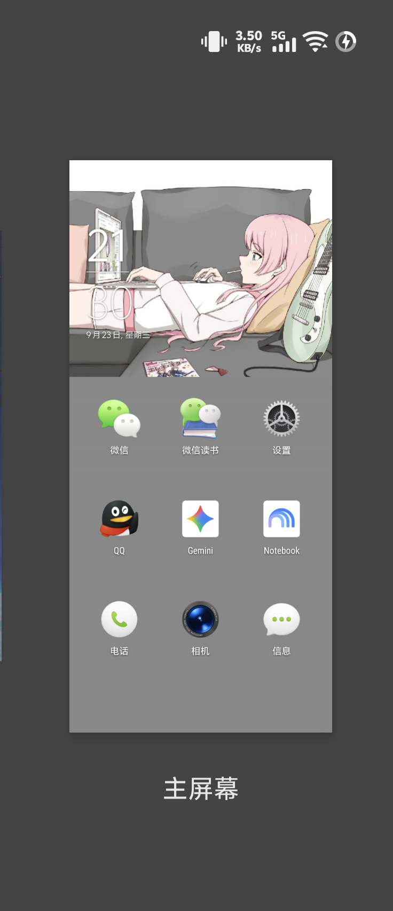

# 一加氢桌面 (H2Launcher) Android 14+ / 16 现代适配版

<p align="center">
  
</p>

<p align="center">
  <b>重温一加氢 OS（H2OS）核心设计哲学：33% 自由视窗、沉浸调色盘与呼吸感卡片流</b><br>
  深度重构适配现代 Android（8.0 ~ 16），根治 33% 视窗横屏拉伸顽疾，独创视窗分层全景 StackBlur 动态模糊引擎。
</p>

<p align="center">
  
  
  
  
</p>

---

## 📖 项目简介 (Overview)

**一加氢桌面（Hydrogen OS Launcher / H2Launcher）** 是一加手机在氢 OS 时代最具代表性的原创作品。其标志性的 **33% 自由视窗** 仅将壁纸呈现于屏幕顶部约三分之一处，其余区域由基于壁纸色调智能萃取的沉浸调色盘和小部件构成，创造出极具艺术留白感与秩序美的视觉体验。

然而，原版 H2Launcher（版本 `v1.6.1.190514143941.58119eb`）由于年久失修，在现代 Android 环境（尤其是 **Android 14 / 15 / 16** 及主流第三方定制系统如 vivo OriginOS、ColorOS、HyperOS 等）上面临诸多严重缺陷：
1. **安装拦截**：Android 14+ 默认阻断 low targetSdkVersion（targetSdk 26）应用安装；
2. **33% 视窗横屏壁纸严重放大拉伸（历史顽疾）**：用户在 33% 模式下选中横屏壁纸，保存后被强制特写拉近，丢失画面两侧 50% 以上构图；
3. **“桌面模糊背景”功能彻底失效**：原版依赖氢 OS 系统专属的 `BlurWallpaper` LiveWallpaper 服务，在非一加系统或现代 Android 上降级为静态壁纸后，副屏毛玻璃效果无法触发；
4. **高版本兼容性闪退**：高版本 Android 移除了 RenderScript 驱动，调用底层高斯模糊直接引发 Crash。

本项目通过逆向 Smali 字节码级手术与核心逻辑重写，**彻底根治了 33% 视窗横屏壁纸拉伸缺陷**，并原创设计了**视窗分层渐变渲染引擎 + 纯 Java 极致优化 StackBlur**，让这款充满情怀的经典桌面在现代旗舰设备与 Android 16 上完美重获新生。

---

## ✨ 核心特性与修复亮点 (Key Features & Fixes)

### 1. 🖼️ 33% 自由视窗横屏壁纸修复（所见即所得）

* **历史顽疾定位**：
  * **根因 1（反向覆写）**：`WallpaperCard$5` 在保存主瓦片后，多余调用了 `saveSecondaryWallpaperTile`，强行对自动生成的竖屏切片执行保存，把系统偏好的瓦片索引覆写为窄切片；
  * **根因 2（AOSP 宽度膨胀）**：`WallpaperUtils.cropBitmap` 与 `createBackground` 遗留了原生 Android 可滚动壁纸的 `maxWidth = requiredWidth * 2` 逻辑，导致原图在合成 33% 视窗时左右各 25% 画面被暴力裁切。
* **彻底根治方案**：
  * 切断 `WallpaperCard` 的 `saveSecondaryWallpaperTile` 覆写调用，锁死保存选中的横屏瓦片；
  * 移除 2x 屏幕宽度膨胀算法，严格统一为 1:1 视口物理像素尺寸；
  * **效果**：选图裁剪、卡片预览与主屏呈现实现 **100% 像素级所见即所得**，全景横屏壁纸零拉伸、零裁剪。

---

### 2. 🌫️ 全新全景 StackBlur 动态模糊背景引擎

* **视窗分层渐变渲染架构**：
  在桌面核心滚动容器 `Workspace.dispatchDraw` 中接入覆盖层绘制，无需系统 LiveWallpaper 特权：
  ```text
  ┌────────────────────────────────────────────────────────┐
  │                        Workspace                       │
  │  ┌──────────────────────────────────────────────────┐  │
  │  │  Page 0 (主屏幕)   │  Page 1 (副屏1)  │  Page 2...   │  │
  │  │  (33% 视窗壁纸透出) │  (应用图标/部件) │  (图标/部件) │  │
  │  └──────────────────────────────────────────────────┘  │
  │                           ▲                            │
  │                           │ (dispatchDraw 前置拦截)    │
  │  ┌──────────────────────────────────────────────────┐  │
  │  │              BlurWallpaperOverlay                │  │
  │  │   Progress = clamp((scrollX - p0) / (p1 - p0))   │  │
  │  │   Alpha: 0.0 (Page 0) ──► 1.0 (Page 1, 2, 3...)  │  │
  │  └──────────────────────────────────────────────────┘  │
  └────────────────────────────────────────────────────────┘
                              ▲
                              │
                Android 系统静态壁纸 (清晰 33% 视窗)
  ```
* **纯 Java 双向 StackBlur 算法**：
  * 彻底摆脱 Android 16 废弃的 RenderScript，无任何 JNI 或驱动兼容性崩溃隐患；
  * 4x 智能下采样加速，单次模糊耗时仅 **3~4 毫秒**，极度省电；
  * 融合一加经典强调色与暗调混合算法（Alpha 0xF2），复刻原汁原味的氢 OS 毛玻璃质感；
  * 内存级位图常驻缓存，滑动过程中实现 60Hz/90Hz/120Hz 满帧率丝滑过渡；
  * **模糊半径精心定版为 14**：在保留壁纸主体辨识度的同时，赋予副屏幕极具呼吸感的高级毛玻璃景深。

---

### 3. 📱 现代 Android 14+ / 16 深度兼容

* **全面屏与高分屏适配**：
  * 完美适配主流 19.5:9、20:9 乃至 2K 物理分辨率（如 OnePlus 7 Pro 1440x3120）；
  * 精准推导 `Workspace` 巨幅画布（mLeft/mTop）与物理屏幕的视口换算坐标，副屏毛玻璃背景 1:1 严丝合缝对齐；
* **权限与生命周期体系调整**：
  * 适配 Android 13+ 媒体权限（`READ_MEDIA_IMAGES`）与现代存储模型；
  * 优化冷启动壁纸加载流程，杜绝黑屏与卡顿。

---

## 📱 真机实测环境 (Tested Devices)

| 测试机型 | 系统版本 | 屏幕规格 | 实测表现 |
| :--- | :--- | :--- | :--- |
| **OnePlus 7 Pro** (GM1911) | Android 16 (SDK 36) | 2K 1440×3120, 90Hz AMOLED | 33% 视窗正常，副屏模糊视口对齐丝滑流畅，无闪退 |
| **vivo X200 Pro mini** | OriginOS / Android 16 | 1.5K 1216×2640, 120Hz AMOLED | 横屏壁纸所见即所得，壁纸切换即时生效，完美兼容 |

---

## 📂 仓库结构说明 (Repository Structure)

```text
h2launcher/
├── apk_decoded/                     # apktool 反编译工程根目录
│   ├── AndroidManifest.xml          # 清单文件（权限与组件声明）
│   ├── apktool.yml                  # apktool 构建配置文件
│   ├── assets/                      # 预置字体、内置静态壁纸及配置
│   ├── res/                         # 布局、图片、调色盘资源
│   └── smali/                       # 核心 Smali 字节码源码
│       └── net/oneplus/h2launcher/
│           ├── customizations/      # 壁纸设置与瓦片卡片逻辑（含 WallpaperCard 修复）
│           ├── util/                # 尺寸裁剪与壁纸工具（含 WallpaperUtils 修复）
│           └── Workspace.smali      # 桌面容器绘制（含动态模糊绘制引擎拦截）
├── scratch/
│   └── src/                         # 纯 Java 重写算法参考源码（含 StackBlur、Composer 等）
├── README.md                        # 本说明文档
└── .gitignore                       # Git 忽略配置（过滤大体积构建产物）
```

---

## 🛠️ 编译与打包构建 (Build & Sign)

### 1. 前置依赖
- **Java**：JDK 11 或更高版本
- **Apktool**：推荐 v2.9.0 或更高版本
- **签名工具**：`apksigner`（Android SDK build-tools）或 `uber-apk-signer`

### 2. 编译打包 Smali
在项目根目录下执行以下命令：
```bash
apktool b apk_decoded -o h2launcher_rebuilt.apk
```

### 3. 对齐与多版本签名 (v1 + v2 + v3)
现代 Android（Android 11+）强制要求 APK 进行 4 字节对齐并具备 v2/v3 签名：

#### 方案 A：使用 `uber-apk-signer`（推荐，一步到位）
```bash
java -jar uber-apk-signer.jar -a h2launcher_rebuilt.apk --allowResign -o ./
# 输出签名包：h2launcher_rebuilt-aligned-debugSigned.apk
```

#### 方案 B：使用官方 Android SDK 工具链
```bash
# 1. 4 字节对齐
zipalign -p -f -v 4 h2launcher_rebuilt.apk h2launcher_aligned.apk

# 2. 生成调试密钥（若已有可跳过）
keytool -genkeypair -v -keystore debug.keystore -alias debugkey -keyalg RSA -keysize 2048 -validity 10000 -storepass android -keypass android -dname "CN=AndroidDebug"

# 3. v1 + v2 + v3 签名
apksigner sign --ks debug.keystore --ks-key-alias debugkey --ks-pass pass:android --key-pass pass:android --out h2launcher_signed.apk h2launcher_aligned.apk
```

---

## 📲 安装与配置指南 (Installation & Usage)

### 1. 通过 ADB 安装至设备
由于原版 TargetSdkVersion 为 26（Android 8.0），在 **Android 14 / 15 / 16** 设备上安装时，系统包管理器默认会拦截低版本 SDK 应用。请在 `adb install` 时附加 `--bypass-low-target-sdk-block` 参数：

```bash
adb install --bypass-low-target-sdk-block -r h2launcher_signed.apk
```

### 2. 授予必要权限
为了能够正常选择本地相册中的图片作为壁纸，请在终端或系统权限管理中授予存储权限（本应用 targetSdk 为 26，仅需声明 `READ_EXTERNAL_STORAGE`；在 Android 13+ 上系统会自动将其映射为媒体读取权限，无需也无法授予 `READ_MEDIA_IMAGES` 等新版权限）：
```bash
adb shell pm grant net.oneplus.h2launcher android.permission.READ_EXTERNAL_STORAGE 2>/dev/null || true
```

### 3. 启动并开启“桌面模糊背景”
1. 启动桌面：
   ```bash
   adb shell am start -n net.oneplus.h2launcher/net.oneplus.h2launcher.Launcher
   ```
2. 长按桌面空白处 ➔ 进入 **设置** ➔ 开启 **桌面模糊背景** 开关；
3. 进入 **壁纸** ➔ 选择喜欢的图片并裁剪为 **横屏** 模式 ➔ 点击保存；
4. 退出后返回桌面即可体验 100% 所见即所得的 33% 自由视窗，向右滑动屏幕即可感受优雅的全景毛玻璃背景。

---

## ❓ 常见问题 (FAQ)

### Q1: 为什么安装提示 `INSTALL_FAILED_DEPRECATED_SDK_VERSION`？
**A**: Android 14+ 引入了最小安装 SDK 限制（默认拦截低于 Android 6.0/8.0 的旧包）。在终端使用 ADB 安装时附带 `--bypass-low-target-sdk-block` 参数即可顺利安装并正常使用。

### Q2: 为什么主屏幕（第 1 屏）背景不模糊？
**A**: 这是一加氢 OS 的经典设计特色！主屏幕顶部为清晰的 33% 视窗与时钟挂件，下方为沉浸调色盘；**只有向右滑动到副屏幕（第 2 屏、第 3 屏...）时，全屏毛玻璃模糊效果才会渐变显现**，使多应用图标在副屏上清晰易读。

---

## 📜 免责声明与版权 (Disclaimer & Credits)

- 本项目基于一加科技（OnePlus / 欢太）发布的官方 Hydrogen OS 启动器（`net.oneplus.h2launcher`）进行反编译逆向与兼容性修复。
- 软件内所有原有商标、Logo、设计概念及预置壁纸之知识产权均归原权利人所有。
- 本项目开源代码仅供 Android 爱好者、极客玩家学习逆向分析、Smali 字节码修补以及个人情怀怀旧使用，**严禁用于任何商业牟利行为**。
